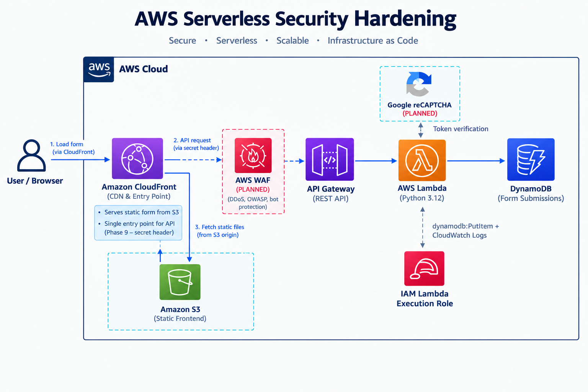

# AWS Serverless Security Hardening

A serverless web application built on AWS, progressively hardened against API abuse, injection attacks, and automated traffic. This project applies IAM least privilege, WAF-based request filtering, server-side validation, and Infrastructure as Code to a public-facing form submission API.

The architecture mirrors a real production incident I managed in year one, where an automated script via a vulnerability scanner bypassed a public-facing web portal's frontend entirely and submitted malicious records directly to the API. This project reconstructs that system on AWS, demonstrates the vulnerable state, and applies the same class of controls that resolved the original incident.

---

## Status

| Component | Status |
|---|---|
| AWS account and baseline security | Completed |
| DynamoDB | Completed |
| Lambda backend | Completed |
| API Gateway | Completed |
| IAM role and permissions | Completed |
| IP-based access restriction | Completed |
| Terraform (IaC) | In Progress |
| Security testing and attack simulation | In Progress |
| Monitoring and logging | In Progress |
| AWS WAF | Planned |
| Server-side reCAPTCHA validation | Planned |
| CSP response headers | Planned |
| CloudFront distribution and S3 frontend | Planned |

---

## Architecture



**Request flow (current):** `POST /submit` → API Gateway (REST, IP-restricted) → Lambda (Python 3.12) → DynamoDB

---

## Results

Before and after evidence is collected by running [`scripts/attack.py`](./scripts/attack.py) against the API at each stage of hardening. Results will be summarised here as each control is added.

| Stage | SQLi / XSS payloads stored | High-volume requests accepted |
|---|---|---|
| Baseline (no controls) | Pending | Pending |
| + AWS WAF | Pending | Pending |
| + Server-side reCAPTCHA | Pending | Pending |

---

## Why I Built This

During a production incident, an automated attack script bypassed frontend validation and submitted thousands of malicious records directly to the API. All CAPTCHA and input validation existed only in the browser. The attacker never touched the browser.

This project exists to work through that failure from first principles on AWS: build the vulnerable state deliberately, demonstrate the attack, then apply controls layer by layer and prove each one works. The goal is not to follow a checklist of AWS services. It is to understand why each control exists and what the system looks like without it.

---

## Technologies

| Technology | Role |
|---|---|
| AWS Lambda | Serverless compute, form processing, validation logic |
| API Gateway | Public HTTPS endpoint, request routing, CORS |
| DynamoDB | NoSQL storage for form submissions |
| IAM | Role-based access control, least privilege enforcement |
| AWS WAF | Request filtering, OWASP rule groups, rate limiting |
| Terraform | Infrastructure as Code, resource provisioning |
| Python 3.12 / boto3 | Lambda runtime, attack simulation script |

---

## Design Decisions

### API Gateway (REST API)

A POST method on `/submit` uses Lambda proxy integration: the full HTTP request is forwarded to Lambda, and Lambda returns the complete HTTP response. An OPTIONS method uses a MOCK integration to answer CORS preflight without invoking Lambda. A resource policy limits access to a single IP address during testing.

*Why not a Lambda function URL or HTTP API?* Neither supports direct WAF attachment. The two-layer WAF defence requires a REST API stage, and the additional complexity is the cost of that control.

### Lambda

Parses the request body, builds a submission record, and writes it to DynamoDB. The table name is injected as an environment variable at deploy time, so nothing environment-specific is hardcoded; the reCAPTCHA secret will follow the same pattern.

Requests with a missing or malformed body are rejected with a 400. Internal errors return a generic message, with full details written only to CloudWatch Logs. Beyond that, the function performs **no content validation, by design**: SQLi and XSS payloads are accepted and stored, and that unvalidated state is the baseline the attack simulation runs against.

*Why Lambda instead of a server?* Form submissions are infrequent and short-lived. Lambda bills per invocation; an EC2 instance would idle continuously for the same workload.

### DynamoDB

Each record uses a random UUID as its partition key, so submissions never collide. On-demand billing removes capacity planning at this scale.

*Why not RDS?* RDS needs a VPC, subnets, and security groups before the database exists. For a key-value record store with no relational model, that complexity provides no benefit.

### IAM Least Privilege

The Lambda execution role has two permissions and nothing else:

- `dynamodb:PutItem` on this one table. Lambda cannot read, scan, update, or delete records, so a compromised function can only write new items.
- `logs:CreateLogStream` and `logs:PutLogEvents` on the function's own log group. The log group is created by Terraform with 14-day retention, so `logs:CreateLogGroup` is not needed.

### WAF at Two Layers (Planned)

WAF will sit on both the API Gateway stage and a CloudFront distribution. In the original incident, WAF existed only at the CDN layer and the attacker bypassed it by calling the API directly. WAF at the API stage catches those requests independently.

### Server-Side reCAPTCHA (Planned)

The original CAPTCHA ran only in the browser. A Python script never executes JavaScript, so it was irrelevant to the attack. Lambda will verify every token with Google before writing to DynamoDB, and reject requests without a valid token with a 400.

### CSP Headers (Planned)

A Content Security Policy at the CloudFront layer will restrict where the browser can load scripts from and connect to: the last line of defence against stored XSS payloads.

### Terraform

All AWS resources are provisioned with Terraform, except one-time account setup (IAM admin user, budget alert, and the state bucket). Console deployments are not reproducible; Terraform makes every change reviewable before it is applied and lets the whole environment be destroyed and rebuilt identically.

State is stored remotely in a versioned, private S3 bucket using the S3 backend with native state locking (`use_lockfile`). This gives one source of truth across machines, a version history to recover a corrupted state file, and a lock that prevents two applies from running at once. The bucket is created by hand rather than by this configuration, because Terraform needs it to exist before it can store state, and keeping it outside the project means `terraform destroy` can never delete its own state.

---

## Hardening Plan

All testing is conducted against infrastructure in my own AWS account.

1. Deploy the baseline application with no security controls beyond IAM
2. Add IP-based restriction to limit the API to the test machine only
3. Run the attack simulation script: SQLi payloads, XSS payloads, high-volume requests
4. Record the before state: all payloads land in DynamoDB, volume requests succeed
5. Add WAF with OWASP managed rule groups and rate limiting, re-run, observe what is blocked
6. Add server-side reCAPTCHA in Lambda, re-run, observe that requests with no valid token are rejected regardless of WAF
7. Add CSP headers and CloudFront secret header, run final simulation, confirm zero records created

---

## Local Setup

**Python** (for the attack simulation script):

```bash
python3 -m venv .venv
source .venv/bin/activate
pip install -r requirements.txt
```

**Terraform** (state is stored in a pre-created S3 bucket, see [Terraform](#terraform)):

```bash
cd terraform
# create terraform.tfvars with aws_region, project_name, and my_ip (your public IP as x.x.x.x/32)
terraform init
terraform plan
```

---

## Lessons Learned

Full write-ups, each with problem, investigation, root cause, resolution, and lesson, are in [docs/lessons-learned.md](./docs/lessons-learned.md).

- [Serverless runtime has no access to local files](./docs/lessons-learned.md#serverless-runtime-has-no-access-to-local-files): runtime config must come from the infrastructure layer, not `.tfvars` or `.env`.
- [Lambda permission and IAM are two separate permission systems](./docs/lessons-learned.md#lambda-permission-and-iam-are-two-separate-permission-systems): IAM controls what Lambda can do; `aws_lambda_permission` controls who can call it.
- [Terraform does not roll back on failure](./docs/lessons-learned.md#terraform-does-not-roll-back-on-failure): a failed apply is safe to retry because state records what succeeded.
- [API Gateway resource policy changes require a redeployment](./docs/lessons-learned.md#api-gateway-resource-policy-changes-require-a-redeployment): a `triggers` block ties policy changes to new deployments.
- [Duplicate deployments from Terraform state drift](./docs/lessons-learned.md#duplicate-deployments-from-terraform-state-drift): Terraform only manages what is in its state file, and never adopts existing resources automatically.

---

## Roadmap

- [x] AWS account setup, MFA, IAM admin user, budget alert
- [x] DynamoDB table provisioned with Terraform
- [x] Lambda function deployed and tested
- [x] API Gateway REST API with POST and OPTIONS, tested with curl
- [x] IAM execution role with least privilege permissions
- [x] IP-based access restriction for testing phase
- [ ] Attack simulation script and before-state evidence
- [ ] AWS WAF with OWASP managed rules and rate limiting
- [ ] Server-side reCAPTCHA validation in Lambda
- [ ] CloudFront distribution and S3 static frontend
- [ ] CSP response headers via CloudFront
- [ ] CloudFront secret header to close direct API bypass
- [ ] After-state evidence and attack simulation comparison
- [x] Remote Terraform state (S3 backend with locking)
- [ ] Monitoring and CloudWatch log review
- [ ] Final architecture documentation and Loom walkthrough

---

## Repository Structure

```
aws-serverless-security-hardening/
├── terraform/
│   ├── main.tf
│   ├── variables.tf
│   ├── outputs.tf
│   ├── dynamodb.tf
│   ├── iam.tf
│   ├── lambda.tf
│   ├── api_gateway.tf
│   ├── waf.tf              (planned)
│   ├── s3.tf               (planned)
│   └── cloudfront.tf       (planned)
├── lambda/
│   └── handler.py
├── scripts/
│   └── attack.py           (in progress)
├── docs/
│   ├── architecture.png
│   └── lessons-learned.md
├── evidence/               (planned)
│   ├── before/
│   ├── after-waf/
│   └── after-recaptcha/
├── requirements.txt
└── README.md
```
